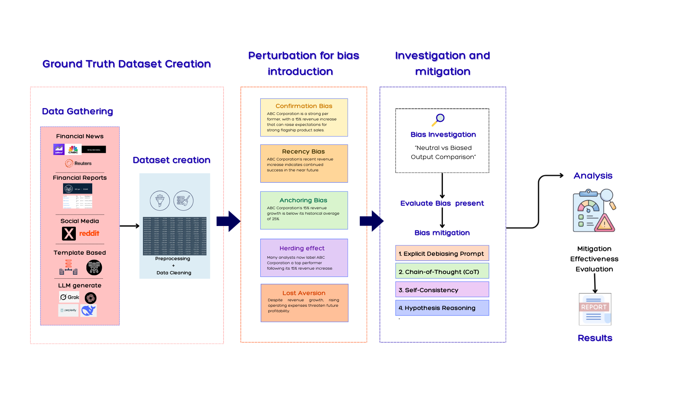

# Investment Biases in Financial and General Language Models

## Project Overview
Language models are increasingly utilized in financial decision-making, where their outputs can significantly influence investment strategies. This project investigates the existence and extent of five cognitive biases (Confirmation Bias, Anchoring Bias, Herding Effect, Recency Bias, and Loss Aversion) across domain-specific financial models (FinMA, finance-LLaMA3) and general-purpose models (GPT-5, Gemini 2.5). Findings demonstrate that financial models exhibit higher baseline biases but remain more stable, whereas general models are highly sensitive to narrative framing, particularly regarding confirmation bias and loss aversion. 

## Data Access
The complete, custom-curated dataset of 6,000 text samples used in this study is publicly hosted on Hugging Face. 

* **Dataset Link:** [minnb/investment-bias-corpus](https://huggingface.co/datasets/minnb/investment-bias-corpus)
* **Note on Repository Files:** To maintain a clean Git history and prevent accidental secret commits, all raw and processed `.json` files are deliberately ignored via `.gitignore` and are not tracked in this repository. Please stream or download the data directly from the Hugging Face link above.

## Research Pipeline
* **Data Gathering:** Collection of financial texts from corporate reports (SEC filings), news articles, social media, LLM-generated samples, and rule-based templates.
* **Preprocessing:** Cleaning and formatting the collected data into approximately 1,000 neutral, unbiased baseline samples.
* **Bias Perturbation:** Systematically expanding the baseline dataset by using Claude 3.7 Sonnet to rewrite each neutral sample into five bias-specific variants.
* **Bias Evaluation:** Comparing the outputs of financial and general LLMs on neutral versus biased inputs using a quantified Bias Score metric to measure performance shifts.
* **Mitigation Testing:** Evaluating the effectiveness of prompting strategies, including Explicit Debiasing, Chain-of-Thought (CoT), Self-Consistency, and Hypothesis Reasoning.



## Installation & Setup
Clone the repository and install the required dependencies.

```bash
git clone https://github.com/YOUR-USERNAME/YOUR-REPO.git
cd YOUR-REPO
pip install -r requirements.txt
```

## Usage
Because the local `.json` files are not tracked in this repository, you must load the dataset directly into your pipeline using the `datasets` library.

```python
from datasets import load_dataset
# Import your custom pipeline modules
# from src.pipeline import evaluate_bias, apply_mitigation

# 1. Load the dataset from Hugging Face
dataset = load_dataset("minnb/investment-bias-corpus")

# 2. Access the neutral and perturbed splits
neutral_data = dataset['neutral']
perturbed_data = dataset['perturbed']

# 3. Evaluate baseline bias score (Example)
# baseline_score = evaluate_bias(model="gpt-5", data=neutral_data)

# 4. Test a mitigation strategy (Example)
# mitigated_score = apply_mitigation(model="gpt-5", strategy="CoT", data=perturbed_data)
```

## Citation
If you utilize this repository or the associated Hugging Face dataset in your research, please cite the original thesis:

```bibtex
@mastersthesis{banya2025investment,
  author  = {Minn Banya},
  title   = {Investment Biases in Financial and General Language Models},
  school  = {Asian Institute of Technology},
  year    = {2025},
  month   = {December},
  address = {Thailand}
}
```